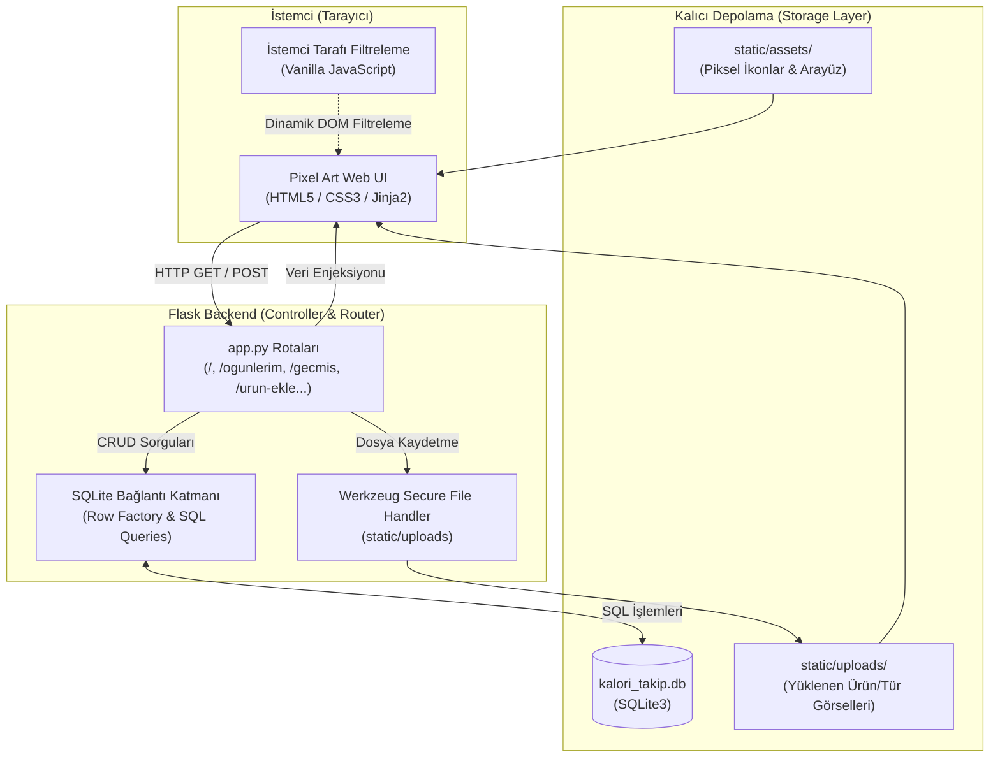
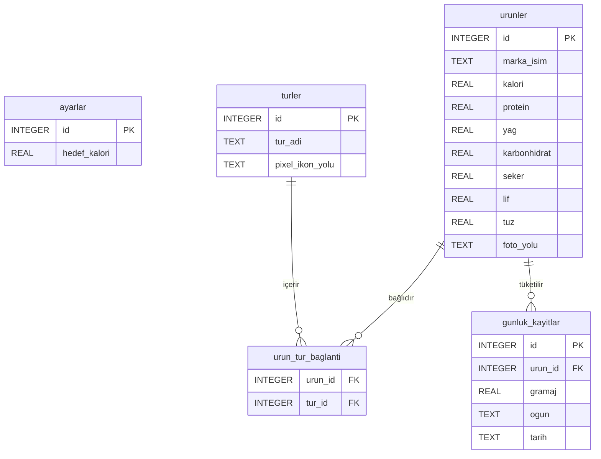

# 🛡️ KALORİ TAKİP | Pixel-Art Beslenme & Kalori Takip Sistemi

> **Beslenme takibini sıkıcı bir veri tablosundan çıkarıp piksel sanatıyla harmanlanmış bir retro RPG envanter yönetimi deneyimine dönüştüren, yerel ve gizlilik odaklı web uygulaması.**

---

<!-- Rozetler -->
<p align="left">
  
  
  
  
  
  
  
  
</p>

---

## 📑 İçindekiler
1. [Proje Hakkında ve Değer Önerisi](#proje-hakkinda)
2. [Problem Tanımı, Amaç ve Çözüm Yaklaşımı](#problem-ve-cozum)
3. [Temel Özellikler](#temel-ozellikler)
4. [Sistem Mimarisi ve Teknoloji Yığını](#mimari-ve-teknoloji)
5. [Proje Klasör Yapısı](#proje-klasor-yapisi)
6. [Veri Modeli, Şema ve Rota Yapısı](#veri-modeli-ve-rotalar)
7. [Kurulum ve Çalıştırma Rehberi](#kurulum-ve-calistirma)
8. [Yol Haritası ve Katkıda Bulunma](#yol-haritasi-ve-katkida-bulunma)
9. [Geliştirici ve İletişim](#gelistirici-ve-iletisim)

---

## 🌟 Proje Hakkında ve Değer Önerisi <a id="proje-hakkinda"></a>

**Kalori Takip**, geleneksel sağlık ve diyet uygulamalarının ruhsuz form girişlerini geride bırakan; retro oyun estetiği, arcade tarzı menüler ve **Hades** oyunundan ilham alan dinamik can/sağlık (HP) barı mekaniği ile beslenme takibini keyifli bir alışkanlığa dönüştüren açık kaynaklı bir web platformudur.

Kullanıcıların günlük kalori bütçesini oyunlardaki can çubuğu mantığıyla görselleştirir, besinleri 16x16 piksel ikonlu kategoriler altında sınıflandırır ve tüketilen her gramajın kalori ve makro besin karşılığını anlık olarak hesaplar.

> [!NOTE]
> Proje **Offline-First** (çevrimdışı öncelikli) mimariye sahiptir. Tüketim alışkanlıklarınız, sağlık hedefleriniz ve kişisel kayıtlarınız hiçbir üçüncü taraf sunucuya veya buluta iletilmez; tamamen yerel cihazınızdaki SQLite veritabanında güvenle saklanır.

---

## 🎯 Problem Tanımı, Amaç ve Çözüm Yaklaşımı <a id="problem-ve-cozum"></a>

### Mevcut Durum ve Problem
* **Karmaşık & Dikkat Dağıtıcı Arayüzler:** Popüler kalori takip uygulamaları binlerce gereksiz özellik, agresif bildirimler ve abonelik kilitleri ile kullanıcıyı yorar.
* **Gizlilik ve Veri Güvenliği Eksikliği:** Kullanıcıların sağlık ve günlük tüketim verileri merkezi şirket sunucularında toplanır ve işlenir.
* **Motivasyon Kaybı:** Tablo benzeri sıkıcı veri girişi, düzenli takip disiplinini kısa sürede sekteye uğratır.

### Çözüm ve Mimari Avantaj
* **Oyunlaştırma (Gamification):** Kalori limitiniz bir oyun can barıdır. Hedefe yaklaştıkça ve limit aşıldığında renk değiştiren dinamik görsel geri bildirim sunulur.
* **Özgür ve Bağımsız Envanter:** Kendi ürünlerinizi (kalori, protein, yağ, karbonhidrat, şeker, lif, tuz değerleriyle) ve kendi özel türlerinizi (kendi 16x16 piksel ikonlarınızla) dilediğiniz gibi oluşturabilirsiniz.
* **Sıfır Dış Bağımlılık:** Harici API, token veya bulut hesabı gerektirmez. Klonla, sanal ortamı kur ve çalıştır sadeliğindedir.

---

## ⚡ Temel Özellikler <a id="temel-ozellikler"></a>

| Modül / Özellik | Kullanıcıya Sağladığı Fayda ve İşleyiş |
| :--- | :--- |
| **🎮 Hades Can Barı & Hedef Takibi** | Günlük kalori hedefinizi tek tıkla güncelleyin. Toplam tüketilen kaloriyi, belirlenen hedefe oranlayarak anlık doluluk yüzdesi ve dinamik renk geçişiyle (kırmızı/altın) görselleştirir. |
| **🍱 4 Farklı Öğün Blokları** | Günlük beslenmenizi **Sabah**, **Öğle**, **Akşam** ve **Atıştırmalık** olmak üzere 4 temel kategoride yönetin. Her öğün için tüketilen ürünleri ve hesaplanan anlık kalorileri listeleyin. |
| **🏷️ İlişkisel Çoklu Kategori (Tür) Sistemi** | Ürünleri tek veya birden çok türe (örn. *Atıştırmalık*, *Kahvaltılık*, *İçecek*) bağlayabilen N:M (Many-to-Many) ilişki desteği. Kendi piksel ikonlarınızı yükleyerek kategori kütüphanenizi genişletebilirsiniz. |
| **🔍 Dinamik Kategori Bazlı Filtreleme** | Öğün kaydederken JavaScript tabanlı anlık filtreleme sayesinde, seçilen türe ait ürünler dropdown menüde otomatik listelenir; ürün bulma süreci hızlanır. |
| **📦 Zengin Ürün Envanteri** | Ürün adı, 100g başına kalori, protein, yağ, karbonhidrat, şeker, lif, tuz değerleri ve görsel yükleme desteğiyle eksiksiz besin profili oluşturma. |
| **📅 Geçmiş Günlük ve Makro Analizi** | Önceki günlerin kayıtlarını tarihe göre arşivler. Geçmiş güne tıklandığında tüketilen tüm gıdalar ve toplam **Kalori**, **Protein**, **Yağ**, **Karbonhidrat** makroları özet panelinde sunulur. |
| **🗑️ Esnek Kayıt Yönetimi** | İster tekil bir öğün kaydını, ister ürün kütüphanesindeki bir besini kalıcı olarak güvenle silebilirsiniz. |

---

## 🏗️ Sistem Mimarisi ve Teknoloji Yığını <a id="mimari-ve-teknoloji"></a>

Uygulama, Python mikro-çerçevesi **Flask** üzerine inşa edilmiş monolitik ve hafif bir **MVC (Model-View-Controller)** mimarisini takip eder.

### 📐 Mimari Veri Akış Diyagramı



### 🛠️ Teknoloji Yığını

| Katman / Kütüphane | Sürüm | Kullanım Amacı ve Tercih Nedeni |
| :--- | :--- | :--- |
| **Python** | `3.10+` | Uygulama çekirdeği, iş mantığı, makro/kalori matematiksel hesaplamaları. |
| **Flask** | `3.1.2` | Minimalist, hızlı ve esnek WSGI web uygulama çatısı; gereksiz boilerplate kod içermez. |
| **Jinja2** | `3.1.6` | Sunucu taraflı dinamik şablon render motoru (`jinja2.ext.do` eklentisiyle şablon içi hesaplama desteği). |
| **Werkzeug** | `3.1.5` | WSGI yardımcı programları ve güvenli dosya adı işleme (`secure_filename`). |
| **SQLite3** | Standart Kütüphane | Sıfır konfigürasyonlu, dosya tabanlı, ACID uyumlu ilişkisel veritabanı. |
| **HTML5 & CSS3** | Standart | Retro piksel yazı tipleri, `image-rendering: pixelated` render özellikleri ve özel tema. |

---

## 📁 Proje Klasör Yapısı <a id="proje-klasor-yapisi"></a>

```bash
Kalori-Takip/
├── .gitignore               # Sürüm kontrolünden hariç tutulan dosya ve klasörler
├── README.md                # Kapsamlı proje dokümantasyonu
├── app.py                   # Flask ana uygulama dosyası, rotalar ve veritabanı yönetimi
├── kalori_takip.db          # Yerel SQLite veritabanı dosyası (ilk çalıştırmada otomatik oluşur)
├── log.txt                  # Sunucu çalışma ve erişim günlükleri
├── requirements.txt         # Python paket bağımlılıkları listesi
├── static/                  # Statik istemci dosyaları
│   ├── assets/              # Sabit piksel sanat arayüz ikonları ve menü görselleri
│   │   ├── ikon_aksam.png
│   │   ├── ikon_atistirmalik.png
│   │   ├── ikon_ogle.png
│   │   ├── ikon_sabah.png
│   │   ├── menu_kutuphane.png
│   │   ├── menu_ogun.png
│   │   ├── menu_takvim.png
│   │   ├── menu_tur_ekle.png
│   │   └── menu_urun_ekle.png
│   └── uploads/             # Kullanıcı tarafından yüklenen ürün ve tür ikonları
└── templates/               # Jinja2 HTML şablonları
    ├── gecmis.html          # Kayıtlı geçmiş günlerin listelendiği takvim görünümü
    ├── gun_detay.html       # Seçilen güne ait tüketim ve toplam makro besin analiz raporu
    ├── index.html           # Ana sayfa: Hades kalori barı ve ana menü navigasyonu
    ├── ogunlerim.html       # Günlük 4 öğünün yönetildiği ve tüketimlerin girildiği panel
    ├── tur_ekle.html        # Yeni ürün türü (kategori) ve piksel ikon yükleme formu
    ├── urun_ekle.html       # Yeni ürün kaydı ve 100g makro değerleri giriş formu
    ├── urunler.html         # Alternatif öğün ekleme ürün listesi şablonu
    └── urunler_listesi.html # Tür filtreli tüm ürün envanter kütüphanesi görünümü
```

---

## 🗄️ Veri Modeli, Şema ve Rota Yapısı <a id="veri-modeli-ve-rotalar"></a>

### 1. Veritabanı Varlık-İlişki Diyagramı (ERD)



### 2. Tablo Şemaları

<details>
<summary><b>🔍 SQLite Tablo Tanımlarını Görüntülemek İçin Tıklayın</b></summary>

```sql
-- 1. Ayarlar Tablosu
CREATE TABLE IF NOT EXISTS ayarlar (
    id INTEGER PRIMARY KEY,
    hedef_kalori REAL
);

-- 2. Türler (Kategoriler) Tablosu
CREATE TABLE IF NOT EXISTS turler (
    id INTEGER PRIMARY KEY AUTOINCREMENT,
    tur_adi TEXT,
    pixel_ikon_yolu TEXT
);

-- 3. Ürünler Tablosu (100 gram bazında değerler)
CREATE TABLE IF NOT EXISTS urunler (
    id INTEGER PRIMARY KEY AUTOINCREMENT,
    marka_isim TEXT,
    kalori REAL,
    protein REAL,
    yag REAL,
    karbonhidrat REAL,
    seker REAL,
    lif REAL,
    tuz REAL,
    foto_yolu TEXT
);

-- 4. Ürün - Tür N:M Bağlantı Tablosu
CREATE TABLE IF NOT EXISTS urun_tur_baglanti (
    urun_id INTEGER,
    tur_id INTEGER
);

-- 5. Günlük Öğün Kayıtları Tablosu
CREATE TABLE IF NOT EXISTS gunluk_kayitlar (
    id INTEGER PRIMARY KEY AUTOINCREMENT,
    urun_id INTEGER,
    gramaj REAL,
    ogun TEXT,
    tarih TEXT
);
```
</details>

### 3. Besin Hesaplama Formülü

Uygulamada tüketilen porsiyona göre değerler aşağıdaki matematiksel bağıntıyla dinamik olarak hesaplanır:

$$\text{Tüketilen Kalori (kcal)} = \left(\frac{\text{Ürün Kalorisi}}{100}\right) \times \text{Tüketilen Gramaj}$$

$$\text{Hedef Tamamlanma Yüzdesi (\%)} = \text{round}\left(\frac{\sum \text{Günlük Kalori}}{\text{Hedef Kalori}} \times 100\right)$$

$$\text{Makro Besin (g)} = \left(\frac{\text{Ürün Makro Değeri}}{100}\right) \times \text{Tüketilen Gramaj}$$

### 4. Flask Rota ve Uç Nokta Listesi

| Rota | Metot | Açıklama |
| :--- | :--- | :--- |
| `/` | `GET` | Ana sayfa; bugünün toplam kalorisini, hedefi ve Hades barı yüzdesini gösterir. |
| `/hedef-guncelle` | `POST` | Günlük hedef kaloriyi günceller ve ana sayfaya yönlendirir. |
| `/tur-ekle` | `GET, POST` | Yeni kategori türü tanımlar ve piksel ikon dosyasını `static/uploads/` dizinine kaydeder. |
| `/urun-ekle` | `GET, POST` | Yeni ürün, makro besin değerleri, tür eşleştirmeleri ve ürün görselini kaydeder. |
| `/urunler` | `GET` | Ürün envanter kütüphanesini görüntüler (`?all=True` veya kategori seçimi destekli). |
| `/urunler/<int:tur_id>`| `GET` | Belirli bir türe/kategoriye ait ürünleri filtreleyerek listeler. |
| `/urun-sil/<int:urun_id>` | `GET` | Ürünü ve bağlı tür eşleşmelerini veritabanından kalıcı olarak siler. |
| `/ogunlerim` | `GET` | Bugünün 4 ana öğününü, kayıtlı tüketimleri ve yeni öğün ekleme formlarını gösterir. |
| `/kaydet` | `POST` | Seçilen öğüne ürün ve gramaj kaydeder. |
| `/kayit-sil/<int:kayit_id>` | `GET` | Belirtilen tekil öğün kaydını siler ve gelinen sayfaya geri döner. |
| `/gecmis` | `GET` | Kayıt bulunan tüm geçmiş günlerin tarih listesini sunar. |
| `/gecmis/<tarih>` | `GET` | İlgili güne ait tüm öğün kayıtlarını ve toplam makro analiz özetini listeler. |

---

## 🚀 Kurulum ve Çalıştırma Rehberi <a id="kurulum-ve-calistirma"></a>

Projeyi yerel makinenizde dakikalar içinde ayağa kaldırmak için aşağıdaki adımları sırasıyla uygulayınız.

### 📋 Ön Gereksinimler
* **Python**: Sürüm 3.10 veya üzeri
* **Pip**: Python paket yöneticisi
* **Git**: Sürüm kontrol sistemi

### 🔧 Adım Adım Kurulum

1. **Depoyu Klonlayın:**
   ```bash
   git clone https://github.com/HakanURAL06/Kalori-Takip.git
   cd Kalori-Takip
   ```

2. **Python Sanal Ortamını (venv) Oluşturun ve Aktive Edin:**
   * **macOS / Linux:**
     ```bash
     python3 -m venv venv
     source venv/bin/activate
     ```
   * **Windows:**
     ```cmd
     python -m venv venv
     venv\Scripts\activate
     ```

3. **Gerekli Paket Bağımlılıklarını Yükleyin:**
   ```bash
   pip install -r requirements.txt
   ```

4. **Uygulamayı Başlatın:**
   ```bash
   python3 app.py
   ```

> [!TIP]
> `app.py` dosyası varsayılan olarak `app.run(host='0.0.0.0', port=0)` şeklinde yapılandırılmıştır. İşletim sisteminiz uygulamaya otomatik olarak boşta olan dinamik bir port atar. Terminal çıktısındaki adresi (örneğin `http://127.0.0.1:51023`) tarayıcınızda açabilirsiniz.
> 
> Sabit bir portta (örneğin port 5000) çalıştırmak isterseniz:
> ```bash
> flask run --port=5000
> ```
> veya `app.py` dosyasındaki son satırı `app.run(host='127.0.0.1', port=5000, debug=True)` olarak güncelleyebilirsiniz.

---

## 🗺️ Yol Haritası ve Katkıda Bulunma <a id="yol-haritasi-ve-katkida-bulunma"></a>

### 📌 Geliştirme Yol Haritası (Roadmap)
- [ ] **Arama & Anlık Otomatik Tamamlama:** Ürün listesinde canlı arama (live search) çubuğu.
- [ ] **Makro Hedef Barları:** Sadece kalori değil; günlük Protein, Karbonhidrat ve Yağ hedefleri için de mini Hades barları.
- [ ] **Veri İçe/Dışa Aktarma (Export/Import):** Beslenme geçmişini JSON veya CSV olarak dışa aktarabilme.
- [ ] **Responsive Mobil Tasarım:** Piksel estetiğini koruyarak akıllı telefon tarayıcılarına optimize edilmiş arayüz düzenlemeleri.
- [ ] **Konteyner Desteği:** Tek tıkla ayağa kaldırma için `Dockerfile` ve `docker-compose.yml` entegrasyonu.
- [ ] **Otomasyon Testleri:** Temel rotalar ve makro hesaplamaları için `pytest` test paketi.

### 🤝 Katkıda Bulunma Rehberi

Her türlü katkıya, hata bildirimine ve özellik önerisine açığız! Katkıda bulunmak için:

1. Bu depoyu forklayın (**Fork** butonuna tıklayın).
2. Özellik veya düzeltmeniz için yeni bir dal (branch) açın:
   ```bash
   git checkout -b feature/harika-yeni-ozellik
   ```
3. Değişikliklerinizi uygulayın ve anlamlı bir mesajla commit yapın:
   ```bash
   git commit -m "feat: dinamik arama ozelligi eklendi"
   ```
4. Dalınızı uzak sunucuya gönderin:
   ```bash
   git push origin feature/harika-yeni-ozellik
   ```
5. GitHub üzerinden bir **Pull Request (PR)** oluşturun.

---

## 👨‍💻 Geliştirici ve İletişim <a id="gelistirici-ve-iletisim"></a>

* **Geliştirici:** Hakan URAL
* **GitHub:** [@HakanURAL06](https://github.com/HakanURAL06)
* **Proje Deposu:** [https://github.com/HakanURAL06/Kalori-Takip](https://github.com/HakanURAL06/Kalori-Takip)

---

<p align="center">
  <b>Kalori Takip</b> ile sağlıklı beslenmeyi piksel dünyasında eğlenceli bir maceraya dönüştürün! 🎮🍎
</p>
